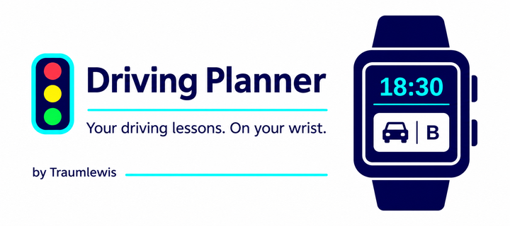

# Driving Planner for Pebble

Driving lessons, reminders and German licence progress on your wrist.

**Release 3.8.2 · Developer: Traumlewis**



[Download the latest GitHub Release](https://github.com/Traumlewis/Driving-license-planner-for-Pebble/releases/latest) · [PBW in this repository](release/Fahrschul-Planer-v3.8.2.pbw) · [English store description](store/description-en.md) · [Deutsche Beschreibung](store/description-de.md)

## Features

- Up to 24 practical/theory appointments, fully manageable on the watch.
- Two adjustable reminders, ten-minute snooze and a confirmation prompt after lesson end.
- All 16 German driving-licence classes with training profiles and saved progress.
- Practical duration in five-minute steps; accumulated extra minutes become 45-minute units.
- Theory checklists, protected checkmark-based totals and separately editable manual units.
- Optional phone settings, automatic synchronization on opening, English/German and Pebble Timeline.
- Device-adapted layouts, licence-class icons, progress bars and remembered menu selection.

## Supported watches

| Platform | Watches | Native screenshot size |
| --- | --- | --- |
| emery | Time 2 | 200 × 228 |
| flint | Core 2 Duo | 144 × 168 |
| gabbro | Round 2 | 260 × 260 |
| basalt | Time / Time Steel | 144 × 168 |
| diorite | Pebble 2 / Pebble 2 SE | 144 × 168 |
| chalk | Time Round | 180 × 180 |

One PBW contains all six platforms. Touch controls are available on Time 2 and Round 2; all models support buttons. The original Pebble and Pebble Steel are not included.

## Install

Open `release/Fahrschul-Planer-v3.8.2.pbw` with the Pebble app and install over an existing copy. Keep the existing installation to retain data; do not uninstall first. The application UUID and storage format remain unchanged.

This normal release consolidates the previous DEV work, including the compact Time Round headings. All native programs now use version 3.8.2 and developer Traumlewis. The release number was deliberately selected for the public release.

## Build

Requires Pebble SDK **4.44**, the Pebble CLI and Python 3.

```sh
python3 tools/build_all.py
# Or select the CLI explicitly:
python3 tools/build_all.py --pebble /path/to/pebble
```

Edit `release.json` to change the release version. `tools/sync_release.py` updates each package, visible guide versions, DE/EN translations and the credits footer before building. It regenerates `VERSION`. Do not update watch versions individually.

The five projects preserve the tested device layouts:

- `projects/time2`: emery
- `projects/core2duo`: flint
- `projects/round2`: gabbro
- `projects/time-pebble2`: basalt and diorite
- `projects/timeround`: chalk

The build script cleans/builds each project, verifies common JS/configuration and release metadata, and produces the combined PBW and SHA-256 file in `release/`. `--skip-build` packages existing outputs only if their release metadata is current.

## Store assets and verification

`store/` contains the banner, English/German descriptions and authentic native emulator screenshots. Five primary scenes are supplied per supported watch model. Models sharing a platform share the same UI captures; the screenshot manifest documents these aliases. Promotional banner artwork is separate from native screenshots.

`docs/verification/` contains additional German and English guide/credits captures. `docs/TESTING.md` records the release validation. Runtime test helpers are in `tools/`; existing project tests remain under each project's `tests/` directory.

## Credits

Idee by Traumlewis | Code by Codex

## GitHub Releases

The Publish GitHub Release workflow validates the checked-in PBW, packages source/store ZIPs and checksum files, uploads them to a draft, and publishes the completed release. It runs when a PBW or release metadata is pushed to main and can also be started manually from Actions. Existing published releases are kept unchanged.
